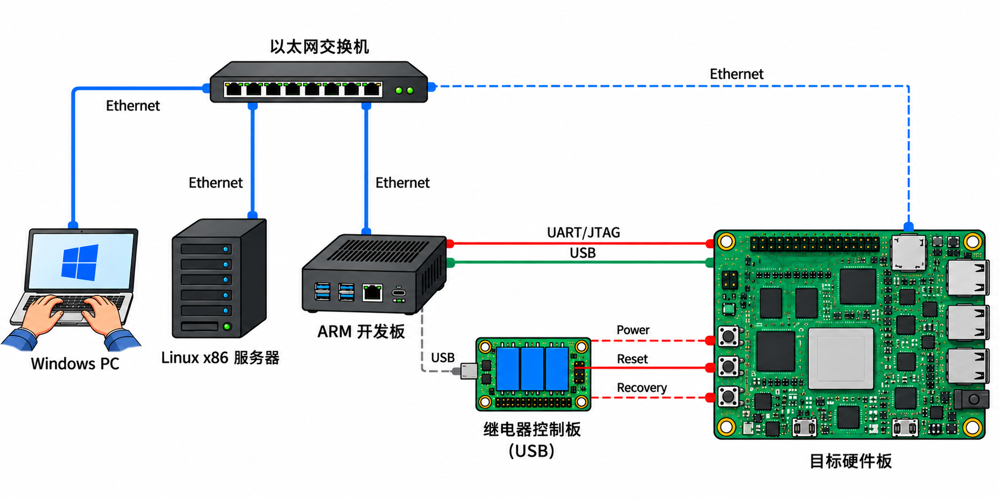

# Embedded Debug MCP Server

`sermcp` 通过 ser2net 连接嵌入式设备，提供串口命令执行、启动阶段识别、崩溃检测、日志归档和继电器控制。支持标准 MCP 客户端，不依赖特定 Agent。

仓库提供两个程序：`sermcp` 是 MCP 服务端，支持 stdio 和 Streamable HTTP；`dutabo` 是交互式配置与设备操作 CLI。

- [安装](#安装)
- [项目配置](#项目配置)
- [客户端接入与启动](#客户端接入与启动)
- [使用与日志](#使用与日志)
- [故障排除](#故障排除)
- [开发与验证](#开发与验证)
- [架构](#架构)

## 安装

以下命令适用于 Linux x86_64，需先安装 Rust/Cargo，并将 `~/.cargo/bin` 加入 `PATH`。部署统一使用静态 musl 二进制，避免目标主机的 glibc 版本限制。

### 从 Git 安装

无需手动克隆仓库，同时安装 `sermcp` 和 `dutabo`：

```bash
rustup target add x86_64-unknown-linux-musl
cargo install --git https://github.com/bitshelf/sermcp --locked --target x86_64-unknown-linux-musl
```

### 从本地源码构建并安装

在本仓库根目录（工作区 `Cargo.toml` 所在目录）执行：

```bash
rustup target add x86_64-unknown-linux-musl
cargo install --path ./sermcp --locked --target x86_64-unknown-linux-musl --force
```

安装后检查：

```bash
sermcp --version
dutabo --help
```

## 项目配置

在需要调试的 SDK／项目根目录运行：

```bash
dutabo init
```

通过交互界面创建或更新 `.target.jsonc`，并测试连接。也可以参考[完整配置示例](./references/.target.jsonc.example)手动配置；只支持 JSONC 格式。

| 配置项 | 说明 |
|--------|------|
| `dev_hosts[].ip` | ser2net 所在主机的 IP |
| `dev_hosts[].duts[].dut_name` | DUT 名称，整个配置中唯一 |
| `dev_hosts[].duts[].serial.port` | ser2net 端口，或本地串口设备路径 |
| `dev_hosts[].duts[].serial.baudrate` | 串口波特率，须与设备一致 |
| `dev_hosts[].duts[].target.login_user` / `login_pass` | 自动登录配置，按需填写 |
| `dev_hosts[].duts[].relay` / `control` | 继电器或外部控制配置，按需填写 |

顶层 `serial`、`target`、`relay`、`monitor` 等配置作为全局默认值，DUT 内同名设置优先。未知字段会报错。

`dutabo init` 在 `.mcp.json` 缺少 `sermcp` 条目时创建或补齐该条目，保留已有条目。界面还可选择平台、工作流与客户端，安装项目内的技能和 hooks；具体范围、网络依赖和自定义方式见[项目集成说明](./docs/project-setup.md)。

### 环境变量

| 变量 | 说明 | 默认行为 |
|------|------|----------|
| `TARGET_CONF` | 指定 `.target.jsonc` 路径 | 从当前工作目录向上搜索 |
| `RUST_LOG` | 日志过滤级别，如 `info`、`debug`、`trace` | `info`；`--verbose` 会覆盖此设置 |

配置完成后可只校验配置，不连接设备：

```bash
TARGET_CONF=/path/to/sdk/.target.jsonc sermcp --dry-run
```

## 客户端接入与启动

### MCP 客户端（stdio）

由客户端启动 `sermcp` 子进程，通过 stdin/stdout 交换逐行 JSON-RPC 2.0 消息。启动目录应为 SDK 项目目录，也可通过 `TARGET_CONF` 显式指定配置路径。

Claude Code 使用项目根目录的 `.mcp.json`：

```json
{
  "mcpServers": {
    "sermcp": {
      "command": "sermcp",
      "args": [],
      "env": {
        "TARGET_CONF": "/path/to/sdk/.target.jsonc"
      }
    }
  }
}
```

将示例路径替换为实际绝对路径；从项目目录启动且配置可被搜索到时，可省略 `env`。启动 Claude Code 后，由客户端建立 MCP 连接。

其他 MCP 客户端（如 Zed、Goose）同样配置可执行文件 `sermcp`、项目工作目录或 `TARGET_CONF`；各客户端的配置文件位置与字段遵循其自身格式。项目集成支持的客户端可直接使用 `dutabo init` 生成配置，见[项目集成说明](./docs/project-setup.md)。

需要手动调试 stdio 启动时：

```bash
TARGET_CONF=/path/to/sdk/.target.jsonc sermcp --log-to-stderr --verbose
```

stdio 模式的 stdout 用于 MCP 协议。协议验证请使用 MCP 客户端完成初始化握手，再调用 `tools/list` 确认工具可用。

### HTTP 服务

需要独立运行服务时，在项目目录执行：

```bash
sermcp --http 127.0.0.1:3000
```

HTTP 模式提供 `/mcp`（Streamable HTTP）、`/health`（健康检查）和 `/serial/ws`（串口 WebSocket）。另开终端检查：

```bash
curl http://127.0.0.1:3000/health
```

同一项目只运行一个 MCP 进程，但它会同时连接 `.target.jsonc` 中的所有 DUT，分别维护串口连接、日志、状态和命令队列。`TARGET_DUT_NAME` 不会限制托管范围。多板调用先用 `serial_list_duts` 查看名称，然后在其他工具参数中传入 `dut`，例如 `serial_get_state({"dut":"rk3576-myir"})`；未指定或名称错误会报错。只有一块板时可以继续省略 `dut`。

CLI 的 `dutabo -d rk3576-myir status`、`reboot`、`serial` 等操作会携带选中的名称。HTTP 支持 `/health?dut=rk3576-myir` 和 `/serial/ws?dut=rk3576-myir&history=1`；默认 `/health` 的 `duts` 数组包含所有目标，资源 URI 也带 `?dut=<名称>`。每块板都持续记录自己的日志，某块板断线或被人工接管不会暂停其他板。详细配置与调用示例见 [多 DUT 托管](docs/multi-dut.md)。

项目 hooks 可负责启动共享 HTTP 服务，端口以该项目的实际配置为准。详见 [Claude hooks](./hooks/claude/README.md) 和[项目集成说明](./docs/project-setup.md)。

## 使用与日志

在项目目录通过 CLI 查看设备并打开交互串口，将 `rk3576` 替换为配置中的 DUT 名称：

```bash
dutabo list
dutabo state --dut rk3576
dutabo serial --dut rk3576
```

Agent 通过 MCP 的 `serial_get_state` 查看状态、`serial_send_command` 执行设备命令、`serial_get_logs` 读取日志；硬件控制按项目配置使用 `serial_reset` 等工具。

### 日志位置

- 服务运行日志：`{project}/.dut-serial/mcp.log`。
- 默认 DUT 串口日志目录：`{project}/.dut-serial/<dut_name>/logs/`；配置自定义 `dut_dir` 时以实际目录为准。
- 串口日志包含 `current.serial.log`、`full.serial.log` 和 `boot-NNN_*.log`，用途见下方分段说明。

### 多 Agent 共享与占用状态（busy / dutabo）

多个代码 Agent 在同一项目打开时共享一个 MCP server。第一个 Agent 会话是 Owner，后续会话是 ReadOnly guest。

- `dutabo`：`dutabo serial` 交互会话持有串口；对所有会话生效，引擎状态转移到 `Dutabo`。
- `busy`：另一个 Agent 会话持有 MCP，本会话只读，控制类工具被 `agent_read_only` 拒绝。

### 交互终端与日志回滚

交互模式连接 MCP 时，会先回放 MCP 内存中最近至多 512 KiB 的串口日志，再接收实时输出。本地终端保留最多 10,000 行滚动历史；MCP 重启前或超出窗口的日志请查看 `full.serial.log`。直接连接 ser2net 时，仅能回滚本次连接收到的输出。

- 右侧滚动条：拖动滑块快速定位，点击轨道定位并可继续拖动；点击顶部 `▲` 到最早历史，点击底部 `▼` 回到实时输出。滑块使用低对比度实心灰色，与上下箭头居中对齐；无外框，轨道融入背景。
- 鼠标滚轮：向上/向下查看日志。正文选择复制使用宿主终端支持的 Shift+拖动。
- 滚动条默认启用；设置 `dut.serial.mouse=false` 会关闭鼠标捕获和滚动条。
- `Alt+Home/End`：最早的历史/实时输出。
- 主机拦截翻页键时，使用 `Ctrl-T` 后按 `u/d` 翻页，按 `g/G` 跳到最早历史/实时输出。
- `Ctrl-T q`：退出。PgUp/PgDn 不再绑定本地翻页。

向上滚动后，新输出默认保持阅读位置；按键输入或粘贴时自动回到底部并恢复实时跟随。可在 `~/.config/dutabo/terminal.toml` 的 `[scroll]` 下设置 `jump_on_input=false` 关闭按键回底。普通 `PgUp/PgDn` 仍发送给设备；设备上的 vim/less 等全屏程序仍由滚轮控制。非交互管道输出不回放历史。历史回放需要配套更新 MCP 服务端。

### 串口日志分段

`current.serial.log` 保存当前启动周期的原始输出，`full.serial.log` 连续追加。收到下一次启动的 DDR/SPL 前缀时，前一个周期归档为 `boot-NNN_*.log`，前缀归入新的当前日志；文件名时间是归档时刻。连接时设备已运行的首段可能只有部分周期。`dutabo serial` 直接接管 ser2net 的路径也保存到该 DUT 的日志目录。`dutabo serial` 占用期间仍保存和分段，但不会执行 Agent 自动登录等动作。

归档读取完整磁盘文件，不受 2 MiB 内存缓冲限制；MCP 重启继续追加当前文件。重置请求本身不切段，按实际收到的启动前缀划分；没有可识别前缀的启动无法保证自动分段。默认只保留最近 10 个归档，可用 `.target.jsonc` 的 `monitor.max_archived_logs` 调整；`full.serial.log` 不参与归档清理。

## 故障排除

| 现象 | 排查方式 |
|------|----------|
| 找不到 `sermcp` / `dutabo` | 检查 `~/.cargo/bin` 是否在 `PATH` 中，以及客户端进程是否继承该环境；也可配置可执行文件绝对路径 |
| 配置加载失败 | 在项目目录执行 `sermcp --dry-run`；检查 `.target.jsonc` 或 `TARGET_CONF` 路径及报错字段 |
| 状态栏不显示 | 检查项目配置、客户端 hooks 和服务是否启动；查看 `.dut-serial/mcp.log` |
| `disconnected` | 检查 ser2net 主机与端口；用 `nc -zv <host> <port>` 测试 TCP 可达性 |
| `DUT-off` | 检查供电与串口输出；通过 MCP 发送 `echo ping`，需要时使用已配置的复位工具 |
| 二进制不启动 | 用 `file ~/.cargo/bin/sermcp` 检查架构，用 `ldd ~/.cargo/bin/sermcp` 检查动态依赖；按上方步骤重新安装静态 musl 版本 |
| 第二个实例被拒绝 | 检查同一项目或同一串口的已有服务，优先复用；需要退出时只处理对应实例 |

更多启动参数和诊断日志：

```bash
sermcp --help
sermcp --log-to-stderr --verbose
```

## 开发与验证

以下命令均在本仓库根目录执行。测试使用共享系统资源，须单线程运行。

```bash
# Build for the development host
cargo build --release --locked

# Run library tests
cargo test --locked -p sermcp --lib -- --test-threads=1

# Run tests for one module
cargo test --locked -p sermcp --lib boot_detector -- --test-threads=1

# Run smoke tests
cargo test --locked -p sermcp --test smoke -- --test-threads=1

# Format the whole workspace and check formatting
cargo fmt --all
cargo fmt --all --check

# Lint
cargo clippy --release -- -D warnings
```

部署构建和安装使用上方[安装](#安装)中的 musl 流程。

## 架构



```
                         ┌────────────────────────┐
                         │    Ethernet Switch     │
                         └─┬──────┬──────┬──────┬┘
                           │      │      │      │
                  Ethernet │      │      │      │ Ethernet
                           │      │      │      │
          ┌────────────────┘      │      │      └──-───────────────────────────┐
          │                       │      └───-───-───┐                         │
          ▼                       ▼                  ▼                         ▼

┌──────────────────┐   ┌──────────────────┐   ┌───────────────┐         ┌──────────────────┐
│ Windows PC       │   │ Build Machine    │   │ ARM           │──UART───│ Target Board     │
│                  │   │ Linux x86        │   │               │──USB────│                  │
│ SSH / Client     │   │                  │   │               │.........│ ○ RECOVERY       │
│                  │   │ Claude Code      │   │ ser2net       │─────────│ ○ RESET          │
│                  │   │ MCP Server       │   │ USB Host      │.........│ ○ Power          │
└──────────────────┘   └──────────────────┘   └───────────────┘         └──────▲────▲──────┘
```
